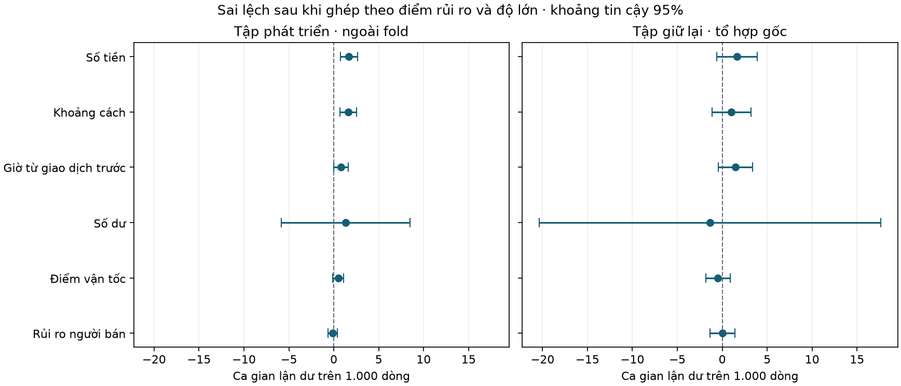

# EDA bổ sung về độ thưa của giá trị giao dịch

**Số tiền có bằng chứng ổn định nhất.** Trên holdout, nhóm chỉ thưa về số tiền làm log loss giảm **0,00031428 trên mỗi dòng trong nhóm**. Nhóm chỉ thưa về khoảng cách có log loss tăng **0,00007039 trên mỗi dòng**, dù thêm khoảng cách làm AUC toàn tập tăng. Thời gian từ giao dịch trước là hướng đáng kiểm tiếp. Tín hiệu xuất hiện rõ hơn khi nhiều tập tham chiếu cùng nhận diện một giá trị là thưa, nhưng mức sai lệch theo số giao dịch trong 24 giờ chưa lặp lại nhất quán. [Số liệu đầy đủ](eda_metrics.json)

## Dữ liệu và cách đo

- Đọc toàn bộ **699.960 dòng train**, **299.984 dòng test** và mẫu submission. Train có **11.689** giao dịch gian lận, chiếm **1,67%**. Không có giá trị thiếu hoặc hàng trùng trong 24 cột đầu vào ở từng tập. Khi đối chiếu chữ ký của 24 cột, số dòng test khớp một dòng train bằng 0. ID dùng để khớp thứ tự.
- Độ lệch train–test nhìn từ phân phối toàn cột nhỏ. Khoảng cách Kolmogorov–Smirnov (độ chênh lớn nhất giữa hai tỷ lệ tích lũy) lớn nhất là **0,00266** ở tuổi thẻ. Độ chênh tần suất cộng dồn các mức phân loại (total variation) lớn nhất là **0,00415** ở ngày trong tuần. Các thống kê này mô tả toàn cột. Mức độ lặp lại của từng giá trị thưa được đo riêng.
- Dùng đúng quy tắc hiệu chỉnh đã chạy. Một giá trị được gọi là thưa khi số lần gặp thấp hơn tần suất quanh nó ở cả hai cửa sổ, tối đa **±5 và ±25 nấc**. Số tiền, khoảng cách, thời gian và số dư dùng nấc **0,01** theo đơn vị gốc. Điểm vận tốc và điểm rủi ro người bán dùng nấc **0,1**. Điểm đang xét được loại khỏi tần suất lân cận. Giá trị ngoài lưới, sát biên hoặc có ít bằng chứng được giảm điểm thưa hoặc nhận 0. [Quy tắc hiệu chỉnh gốc](../BAO_CAO.md) · [Mã EDA](audit.py)
- Sai lệch thô là **số gian lận quan sát trừ số Grandmaster EDA dự kiến**. Sai lệch ghép nhóm trừ thêm sai lệch của các giao dịch có độ lớn và điểm rủi ro tương đương. Dùng năm dải độ lớn lấy từ tập phát triển và mười dải rủi ro. Tính lại với hai cách chia dải rủi ro, một cách theo số dòng và một cách theo tổng `p × (1 − p)`. Cách thứ hai giữ được nhiều dòng hơn ở các vùng xác suất thấp và được dùng trong bảng chính. Các tầng có độ cong logistic của đối chứng dưới 8 được bỏ khỏi phép ghép.
- Điểm cho **594.966 dòng phát triển** là điểm ngoài fold của ba nhánh cuối, dùng biên Grandmaster tầng dưới đã lưu. Điểm cho **104.994 dòng holdout** là xác suất của Grandmaster EDA gốc. Holdout đã được dùng ở các lượt nghiên cứu trước. Test không có nhãn. [Manifest điểm ngoài fold](../development_oof_manifest.json) · [Kết quả mô hình đối chứng](../development_metrics.json)

## Sáu cột trên cùng phép kiểm

Sai lệch trong bảng là số ca gian lận dôi ra sau ghép nhóm trên **1.000 dòng được so sánh**. Giá trị dương cho thấy mô hình đánh giá thấp rủi ro tương đối ở nhóm thưa. Giá trị p dùng xấp xỉ theo từng dòng với hiệu chỉnh Holm cho sáu cột trong từng phép đo. Khoảng tin cậy trên hình là khoảng 95% từng phép so.

| Cột | Phát triển, dòng thưa | Phát triển, ca dư / 1.000 | p Holm | Holdout, dòng thưa | Holdout, ca dư / 1.000 |
|---|---:|---:|---:|---:|---:|
| Số tiền | 49.789 | +1,685 | 0,00313 | 8.655 | +1,637 |
| Khoảng cách từ nhà | 55.474 | +1,617 | 0,00313 | 9.835 | +1,030 |
| Giờ từ giao dịch trước | 79.714 | +0,806 | 0,18161 | 14.011 | +1,462 |
| Số dư tài khoản | 745 | +1,330 | 1,00000 | 143 | −1,376 |
| Điểm vận tốc | 214.491 | +0,491 | 0,31182 | 37.656 | −0,469 |
| Điểm rủi ro người bán | 241.658 | −0,112 | 1,00000 | 42.914 | +0,014 |

Không cột nào trong sáu phép thử rộng trên holdout vượt ngưỡng Holm 0,05. Số tiền và khoảng cách cùng dương ở cả ba fold khi dùng dải điểm theo số dòng. Hai cột này cũng ổn định về dấu và xếp hạng qua hai cách chia dải. Số dư có quá ít dòng hỗ trợ. Điểm vận tốc và điểm người bán gắn cờ nhiều dòng, với sai lệch nhỏ hoặc đổi dấu. [Thống kê theo cột, độ thưa và fold](eda_metrics.json)



## Giá trị thưa nào lặp lại

Tạo ba bản đồ tần suất từ ba phần phát triển không giao nhau. Mỗi dòng phát triển được dò qua hai bản đồ xây từ những phần khác. Mỗi dòng holdout được dò qua cả ba. Đối chứng cho bảng dưới là các dòng có **0 phiếu** trong cùng dải điểm và độ lớn. Các phép thử nhóm này mang tính khám phá.

| Cột | Phát triển, chỉ 1/2 bản đồ | Phát triển, đủ 2/2 bản đồ | Holdout, đủ 3/3 bản đồ | Số dòng holdout đủ 3/3 |
|---|---:|---:|---:|---:|
| Số tiền | +0,005 | **+2,126** | +1,415 | 6.393 |
| Khoảng cách | +0,355 | **+2,007** | +1,189 | 8.201 |
| Giờ từ giao dịch trước | −0,839 | +1,000 | +2,120 | 12.355 |

- **Số tiền.** Khi chỉ thấy ở một bản đồ phát triển, phần dư gần bằng 0. Nhóm **404 mức tiền đã chốt** vẫn nổi bật, với **191 ca so với 154,09 dự kiến** trên phát triển và **46 so với 31,86** trên holdout. Sau ghép nhóm, chênh lệch holdout là **+8,29 ca trên 1.000 dòng**, tương ứng **+13,63 ca**, khoảng 95% **[+5,21, +22,06]**. Đây là đối chứng hẹp đã được chọn và kiểm tra ở các lượt trước.
- **Giờ từ giao dịch trước.** Nhóm được cả ba bản đồ nhận diện có **247 ca so với 222,00 dự kiến** trên holdout. Phép ghép cho p danh nghĩa **0,0414** trước khi tính các lần xem nhóm. Khi tách số giao dịch 24 giờ ở ngưỡng 3, nhóm tối đa 3 giao dịch có hiệu ứng rõ hơn ở phát triển, còn hiệu ứng quan sát trên holdout tập trung ở nhóm trên 3 giao dịch. Chỉ **722/4.207 dòng** ở nhóm trên 3 có đối chứng đủ hỗ trợ trên holdout. Mức chênh này chưa đủ để chốt một tương tác.
- **Đối chiếu với test.** Khi xây bản đồ riêng từ test và chuẩn hóa theo số dòng, độ trùng Jaccard của tập giá trị thưa mạnh là **0,676** cho số tiền, **0,721** cho khoảng cách và **0,816** cho thời gian. Jaccard là số giá trị chung chia số giá trị xuất hiện ở ít nhất một bản đồ. Hai bản đồ cùng nhận diện 553 mức tiền, 575 mức khoảng cách và 500 mức thời gian. Dùng bản đồ test ở đây để đo độ ổn định tần suất. [Định nghĩa danh sách đã chốt](../../deep_eda_measurement/amount_hole_submission.json) · [Thống kê lá phiếu và độ trùng](eda_metrics.json)

## Yếu tố nào giúp mô hình

Tái dựng đúng điểm của bản số tiền + khoảng cách từ các hệ số đã lưu. Sau đó giữ các hệ số ấy và lần lượt bỏ từng thành phần. Đây là phép bỏ thành phần (ablation), giúp thấy đóng góp của từng biến mà không cần học thêm trọng số.

| Điểm trên holdout | ROC AUC | Average Precision | Log loss |
|---|---:|---:|---:|
| Grandmaster EDA gốc | 0,95122445 | 0,53823528 | 0,04383599 |
| Chỉ giữ hệ số số tiền | 0,95133773 | **0,53840955** | 0,04380616 |
| Chỉ giữ hệ số khoảng cách | 0,95128415 | 0,53804202 | 0,04383099 |
| Giữ cả hai | **0,95138773** | 0,53821569 | **0,04380525** |

| Nhóm giao dịch | Dòng | Gian lận | Grandmaster dự kiến | Δ log loss trong nhóm |
|---|---:|---:|---:|---:|
| Cả hai cột đều không bật cờ thưa | 87.325 | 1.435 | 1.421,99 | 0,00000000 |
| Chỉ thưa về số tiền | 7.834 | 138 | 127,67 | −0,00031428 |
| Chỉ thưa về khoảng cách | 9.014 | 163 | 156,23 | +0,00007039 |
| Cùng thưa ở cả hai cột | 821 | 17 | 12,12 | −0,00170515 |

Số dòng cùng thưa là **821**, gần **811** nếu hai cờ độc lập về tần suất. Nhóm này có ít ca gian lận, nên mức giảm log loss lớn trong nhóm chưa xác nhận tương tác. Mức đổi log loss gộp là **−0,00003074**, khoảng tin cậy ghép cặp **[−0,00007416, +0,00001268]**. Phần tăng AUC chủ yếu đến từ các giao dịch gian lận với điểm gốc nằm ở phân vị **50–95**. Nhóm trên phân vị 99 đóng góp xấp xỉ **−0,00000193** vào Δ AUC, phù hợp với việc cần theo dõi chất lượng ở đầu bảng xếp hạng. [Phân rã điểm, dải rủi ro và khoảng tin cậy](eda_metrics.json)

**Ưu tiên kiểm tiếp độ thưa của số tiền khi được nhận diện lặp lại.** Có thể giữ bản hiệu chỉnh 404 mức tiền làm mốc hẹp. Khoảng cách đáng kiểm riêng ở các nhóm rủi ro vì ảnh hưởng lên AUC và log loss khác nhau. Với thời gian, bằng chứng hiện tại đủ để đặt giả thuyết về giá trị lặp lại và chưa ổn định theo số lần giao dịch.

## Nguồn và tái lập

Đầu vào gồm toàn bộ `train.csv`, `test.csv`, `sample_submission.csv` đã khớp SHA-256, trường ID, fold và điểm của `development_oof.npz`, cùng các mảng `grandmaster_eda` và `smooth_amount_distance` trong `development_predictions.npz`. Đọc toàn bộ báo cáo hiệu chỉnh trong `../BAO_CAO.md`, trường `recipes.smooth_amount_distance.feature_coefficients` trong `development_metrics.json` và danh sách cent đã khóa trong `amount_hole_submission.json`. Mã dùng lại hàm `neighbor_deficit` từ `calibrate.py`. Phép kiểm tái dựng đúng điểm hiệu chỉnh đã lưu và kiểm SHA-256 của submission gốc.

Chạy từ thư mục báo cáo sau khi tạo điểm phát triển theo [hướng dẫn hiệu chỉnh](../BAO_CAO.md). Ví dụ dùng cache của workspace tại thư mục cha của repo.

```powershell
$env:GRANDMASTER_CACHE_PROJECT = (Resolve-Path '..\..\..\..\..').Path
python -B audit.py
```
